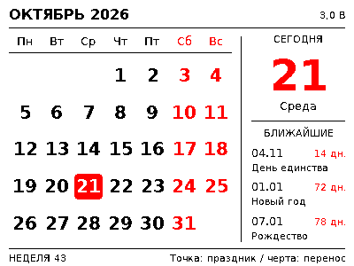

# EPD-nRF5: автономный календарь на русском

Форк [tsl0922/EPD-nRF5](https://github.com/tsl0922/EPD-nRF5), ветка `feature/russian-calendar`.
Русская прошивка рисует календарь на самом Nordic MCU. После синхронизации телефон не нужен.



Превью `bw` — чёрно-белое, `bwr` — трёхцветное, `bwry` — четырёхцветное. Жёлтый для календаря не требуется.

## Что реализовано

- Все месяцы и дни недели на русском, понедельник первым, выделение сегодняшней даты.
- Григорианский календарь, високосные годы, ISO-недели с правильным годом недели.
- Федеральные нерабочие праздники РФ, субботы/воскресенья, переносы и рабочие субботы 2025–2027 годов для пятидневки.
- Точка у числа означает праздник по статье 112 ТК РФ, подчёркивание — перенесённый выходной. Рабочая суббота выводится чёрным.
- За пределами 2025–2027: фиксированные праздники и обычные выходные; надпись «переносы не заданы». Будущие переносы не прогнозируются.
- Кириллица А–Я/а–я, Ё/ё, ASCII и знак градуса: три пропорциональных bitmap-шрифта DejaVu Sans и два цифровых набора U8g2. Китайские таблицы в русскую сборку не входят.
- Русский веб-интерфейс, изображения, кадрирование, рисование и исходные BLE-команды сохранены. Москва UTC+3 по умолчанию, доступны другие целочасовые смещения.
- Обновление календаря раз в сутки в местную полночь. До синхронизации автоматические обновления отключены.

## Статус оборудования

**На физическом ценнике эта версия не проверялась и не устанавливалась.** Маркировка Hema 4,2″ и работающее BLE не подтверждают модель SoC, распиновку, контроллер панели или OTA-ключ.

Подготовлены собираемые конфигурации upstream: nRF52811/совместимая ветвь nRF52810 с S112 7.3.0 и nRF51822/51802 **256 КБ Flash, 16 КБ RAM** с S130 2.0.1. Это кандидаты для известных конфигураций проекта, а не подтверждение совместимости конкретного ценника. Для 128-КБ nRF51 эта ветка не подходит: upstream отсылает к старой ветке `sdk10`.

До выбора образа нужны фотографии обеих сторон платы, маркировка MCU и шлейфа панели, текущие байты конфигурации из веб-интерфейса, версия прошивки, сведения о DFU и по возможности резервная копия Flash/UICR. Таблица плат и драйверов: [аудит](docs/architecture_ru.md).

## Сборка

Проверено на Linux: Arm GNU GCC 12.2.1, binutils 2.40, nano newlib 3.3.0. SDK уже находятся в репозитории.

```sh
sudo apt-get update
sudo apt-get install gcc-arm-none-eabi libnewlib-arm-none-eabi libnewlib-dev gcc python3-pil nodejs
python3 tools/build_firmware.py --chip 52
python3 tools/build_firmware.py --chip 51
python3 tests/test_calendar.py
node tests/test_web.js
python3 tools/render_previews.py
```

Артефакты: `build/nrf52-ru/` и `build/nrf51-ru/`: application HEX, BIN, ELF, MAP и JSON с размерами. HEX содержит только приложение; BIN не содержит адреса загрузки. Нельзя записывать BIN по адресу 0.

Без root можно установить проверенный toolchain через `python3 tools/install_toolchain.py --prefix ../arm-gnu`, затем указать абсолютный `ARM_GCC=/path/to/arm-gnu/usr/bin/arm-none-eabi-gcc`.

Для Linux CI добавлен `.github/workflows/russian-calendar.yml`. Он собирает обе конфигурации и запускает тесты; прошивки доступны как Actions artifacts. Локальные кандидаты с журналами и контрольными суммами: [artifacts](artifacts/README.md).

`--locale baseline` использует исходный набор GUI/Lunar/fonts и исходные размеры памяти; для точного повторения исходной проверки запускайте этот скрипт в checkout upstream `7e3196193997bd6a4644610c41d54a76eff88760`. Это режим аудита, не образ для установки: исходный linker range включает загрузчик. `--locale zh` сохраняет китайский рендерер; на nRF52 он не помещается в уменьшенную безопасную область для OTA с GCC и сознательно отклоняется линкером. Исходные Keil-проекты сохраняют китайскую конфигурацию; русские прошивки собираются скриптом выше.

Windows-эмулятор: `make` собирает русскую версию, `make LOCALE=zh` — китайскую (после переключения выполните `make clean`). Linux-превью не требуют Windows.

## Шрифты

Готовые массивы: `GUI/fonts_ru.c`, набор символов: `tools/font_ru.txt`. Генерация:

```sh
python3 tools/build_fonts_ru.py --bdfconv /path/to/bdfconv
```

Исходники конвертера: [U8g2/tools/font/bdfconv](https://github.com/olikraus/u8g2/tree/master/tools/font/bdfconv), собираются командой `make`. Его ревизия записана в [отчёте](docs/validation_ru.md). Генератор требует Pillow и растеризует включённые в репозиторий подмножества DejaVu Sans: 11/13 px regular, 16 px bold и цифры 20/48 px bold. Промежуточные BDF также сохранены. В прошивку попадают только bitmap-массивы: всего 8184 байта, без TTF-рендерера и полного Unicode-набора.

Макет следует композиции из объявления: месячная сетка слева, крупная текущая дата справа, под ней три ближайшие праздничные даты с количеством дней до них. Шрифты без засечек, нормальные пропорции кириллицы и отдельные крупные цифры. Выходные красные, рабочая суббота чёрная. В монохромном режиме сохраняются выделение сегодняшнего дня и маркеры праздников/переносов.

Шрифты DejaVu, U8g2, Adafruit, Nordic и upstream сохраняют свои лицензии: [DejaVu](tools/fonts/LICENSE-DejaVu.txt), [WenQuanYi для исходной китайской конфигурации](tools/fonts/LICENSE-WenQuanYi.txt), исходные заголовки файлов, [LICENSE](LICENSE). Исходные TTF были сокращены fontTools до ASCII, русского алфавита и знака градуса; включённые подмножества и BDF позволяют регенерировать массивы без системных шрифтов.

## Время и автономность

Откройте `html/index.html` через HTTPS либо локальный сервер на localhost, подключите ценник и нажмите «Календарь и синхронизация». Выберите часовой пояс перед синхронизацией. Существующий BLE-протокол передаёт Unix UTC + знаковое смещение в целых часах; прошивка ведёт местное время без DST. Москва UTC+3 не имеет сезонного перевода. Для зон с DST нужна повторная синхронизация после изменения смещения; дробные смещения интерфейс отклоняет.

Обычное ожидание CPU/System ON сохраняет RTC и дату. Дисплей после обновления засыпает; батарейки не нужны для удержания картинки. System OFF, снятие батарей, WDT/reset и DFU перезапускают MCU и теряют время: при следующем включении показан запрос синхронизации. Без внешнего RTC с резервным питанием обещать сохранение времени после такого сброса нельзя.

LFCLK по умолчанию RC с калибровкой SoftDevice; длительная точность хода не измерена. Внешний кварц включайте только после подтверждения его наличия. Интервалы BLE, GPIO и E-Ink waveform не менялись. У плат с настроенным wakeup pin upstream может останавливать advertising до внешнего пробуждения; у Hema-конфигурации по умолчанию этот pin отключён. Оценка срока работы двух CR2450 без измерений тока не приводится.

Режим часов сохранён, но делает полное обновление каждую минуту и требует подтверждения в интерфейсе. Для постоянного использования выбирайте календарь.

## Подключение с телефона и прошивка

Web Bluetooth: настольные Chrome/Edge и Chrome на Android через HTTPS/localhost; при работе на Linux может требоваться включение experimental web platform features и доступ к Bluetooth. Safari на iPhone не предоставляет обычный Web Bluetooth. Upstream рекомендует Bluefy; его работа с этим устройством не проверена. Проверенный здесь путь ограничивается программными тестами пакетов, а физическое подключение необходимо подтвердить отдельно. Альтернатива — компьютер с Chrome/Edge; для DFU после подтверждения загрузчика — Nordic nRF Connect Device Firmware Update.

Веб-интерфейс сохраняет управление изображениями; OTA выполняется отдельным DFU-клиентом, как в upstream. Полная процедура выбора, резервного копирования, OTA/SWD и восстановления: [flashing_ru.md](docs/flashing_ru.md). **Физическая прошивка требует подтверждения аппаратуры и отдельного разрешения владельца.**

[Источники календаря](docs/holidays_ru.md) · [Архитектура](docs/architecture_ru.md) · [Проверки и ограничения](docs/validation_ru.md) · [Все превью](docs/previews)
